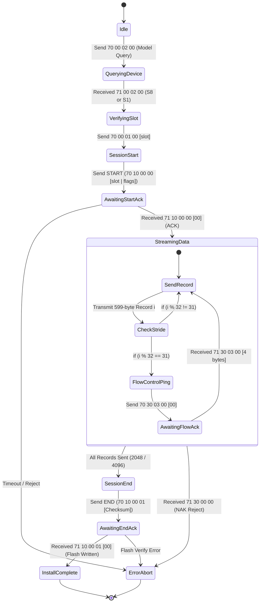

# Volume IV: Firmware Containers, OS & SysEx Protocol

# Chapter 4: USB-MIDI SysEx Installation Protocol & Web Installer

> **Document ID**: TRM-BMC-VOL4-004  
> **Classification**: Normative Protocol Specification  
> **Release Target**: Texas Instruments / Analog Devices TRM Standard  

---

## 4.1 Protocol Framing & Message Structure

The Roland Plug-Out installation and diagnostics interface communicates via standard **Universal System Exclusive (SysEx)** packets routed over the instrument's secondary USB-MIDI interface (**`SYSTEM-8 CTRL`** / **`SYSTEM-1 CTRL`**, typically USB interface endpoint 1 / ALSA port `hw:N,0,1`).

```
 0    1    2    3    4    5    6    7    8    9   10   11       11+L 12+L 13+L
┌────┬────┬────┬────┬────┬────┬────┬────┬────┬────┬────┬─────────┬────┬────┐
│ F0 │ 41 │Dev │ 00 │ 00 │ 7E │Cmd │ A1 │ A2 │ A3 │ A4 │ Data... │ Ck │ F7 │
└────┴────┴────┴────┴────┴────┴────┴────┴────┴────┴────┴─────────┴────┴────┘
```

| Byte Index | Byte Name | Standard Value | Description & Protocol Rules |
|---|---|---|---|
| 0 | `SOX` | `0xF0` | Start of System Exclusive Delimiter. |
| 1 | `MANUFACTURER` | `0x41` | Roland Corporation Manufacturer Identification Code. |
| 2 | `DEVICE_ID` | `0x10` | Device Unit Address (Factory default: Unit ID 17, `0x10`). |
| 3:5 | `MODEL_ID` | `0x00 0x00 0x7E` | Roland Plug-Out System Universal Model ID. |
| 6 | `COMMAND` | `0x12` (`DT1`) | Roland Data Set 1 (`DT1`). Used for queries, data pushes, and flow control. |
| 7:10 | `ADDRESS` | `A1 A2 A3 A4` | 28-bit Big-Endian Memory-Mapped Target Address (7 bits per byte). |
| 11 : 11+$L$ | `DATA` | Variable | Encoded Payload (7-in-8 firmware records, query selectors, or parameter values). |
| 12+$L$ | `CHECKSUM` | Computed | Roland 7-bit Complement Checksum ($0 \le \text{Checksum} \le 127$). |
| 13+$L$ | `EOX` | `0xF7` | End of System Exclusive Delimiter. |

### 4.1.1 Roland 7-Bit Checksum Algorithm `[VERIFIED]`

The checksum byte covers all address bytes (`A1`–`A4`) and data bytes (`D1`–$D_L$):

$$\text{Sum} = \sum_{k=1}^{4} A_k + \sum_{m=1}^{L} D_m$$

$$\text{Checksum} = (-\text{Sum}) \ \& \ \text{0x7F} = (128 - (\text{Sum} \pmod{128})) \pmod{128}$$

### 4.1.2 Request/Reply Address Inversion Rule `[VERIFIED]`
When the instrument acknowledges or answers a host message, **it reflects the request address with bit 21 asserted**:

$$\text{Request Address Prefix: } \text{0x70} \quad \implies \quad \text{Instrument Response Address Prefix: } \text{0x71}$$

---

## 4.2 Device Identification & Slot Status Queries `[VERIFIED]`

Prior to initiating firmware transfers, the host software queries the target hardware via single-byte `DT1` requests:

| Query Message (Hex) | Response Address | Data Length | Payload Semantics |
|---|---|---|---|
| `70 00 02 00 [00]` | `71 00 02 00` | 1 Byte | Hardware Model: `00` = SYSTEM-1, `01` = SYSTEM-1m, `02` = SYSTEM-8. |
| `70 00 01 00 [00]` | `71 00 01 00` | 48 Bytes | Bytes 0–3: Firmware Version in BCD nibbles (e.g. `01 03 02 00` = v1.32). |
| `70 00 02 01 [00]` | `71 00 02 01` | 1 Byte | Patch Bank Multiplier $X$. |
| `70 00 02 02 [00]` | `71 00 02 02` | 1 Byte | Patch Bank Multiplier $Y$ (Total patches = $X \times Y \times 8$). |
| `70 00 02 03 [00]` | `71 00 02 03` | 1 Byte | Total Physical Plug-Out Slots ($N = 1$ on S1, $N = 3$ on S8). |
| `70 00 01 00 [slot]`| `71 00 01 00` | 48 Bytes | Slot Query: Bytes 8–11 = Model ID (`FFFF` if empty), 16–47 = 16-char ASCII Name. |

---

## 4.3 Plug-Out Installation Protocol State Machine

The complete binary installation sequence is governed by a synchronous, flow-controlled state machine:



### 4.3.1 Installation Phase Execution Steps

1. **Session Start (`START`)**:
   - The host sends the container's START message to address `70 10 00 00`.
   - Payload byte: `slot_index | auth_flag`. 
   - `auth_flag = 0x00` (Authenticated) or `0x40` (Bypass authorization).
   - Expected response: `71 10 00 00 [00]`. (Timeout: 5.0 seconds, 3 retry attempts).
2. **Synchronous Data Streaming (`DATA`)**:
   - Loops through all records ($i = 0 \dots \text{count}-1$):
   - Transmits complete 599-byte SysEx data block (`70 30 00 09`).
   - **Flow Control Checkpoint**: Every 32 records ($i \pmod{32} = 31$), the host pauses and issues the flow control query `70 30 03 00 [00]`. It must receive `71 30 03 00` (4 bytes) before transmitting the next record chunk.
3. **Session Finalization (`END`)**:
   - Transmits container's END message to address `70 10 00 01` (4-byte cryptographic image digest).
   - Expected response: `71 10 00 01 [00]`. (Timeout: 20.0 seconds while the Master ARM commits the binary into internal QSPI Flash memory).

---

## 4.4 Flow Pacing & Web MIDI Implementation

When operating within modern web browser runtimes via the Web MIDI API (`navigator.requestMIDIAccess({sysex: true})`), hardware USB-MIDI FIFO queues must not be overrun:

- **Calculated Inter-Message Delay**:
  $$T_{\text{delay}} = 10.0\text{ ms} + (\text{Length}_{\text{bytes}} \times 0.32\text{ ms})$$
- For standard 599-byte firmware blocks, the host enforces a minimum inter-packet spacing of **$12.5\text{ ms}$**.
- Pacing ensures zero dropped packets even when communicating across low-speed USB-MIDI class-compliant hubs.
